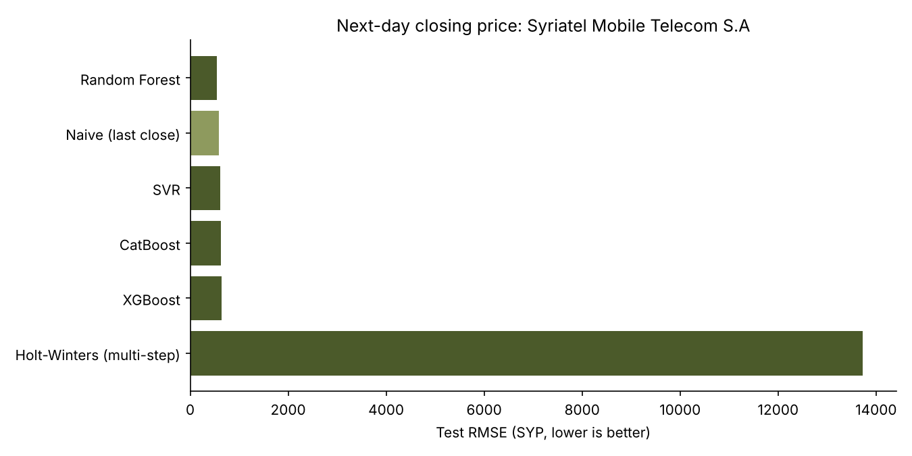

# Damascus Stock Market Forecasting

Forecasting next-day closing prices for companies on the **Damascus Securities Exchange (DSE)**, comparing classical time-series, machine-learning and deep-learning models, and serving the forecast through a REST API with an LLM-generated recommendation.

Master's project, M.Sc. Computer Science, Syrian Virtual University (2024).

## What it does

1. **Data:** 14 years of daily OHLCV prices (2010–2024) for 28 DSE-listed companies.
2. **Model comparison:** trains and scores seven approaches on each company:

   | Family | Models |
   |---|---|
   | Baseline | Naive (tomorrow = today) |
   | Time series | Holt-Winters exponential smoothing |
   | Machine learning | XGBoost, CatBoost, Random Forest, SVR |
   | Deep learning | Stacked LSTM (2 × 50 units, dropout 0.2) |

3. **API:** a Flask service trains Random Forest (the most reliable model in the comparison) for a chosen company, returns the next-day forecast with its test error, detects the trend from 30- vs 60-day moving averages, and asks GPT-Neo 2.7B to phrase a short recommendation.

## Method

- **Target:** next-day return, converted back to a next-day closing price for scoring. Syrian share prices rose many-fold over 2010–2024, mostly through inflation, so a model trained on price levels cannot predict levels it has never seen. Learning returns from scale-free features fixes this.
- **Features on day *t*:** high/close, low/close and open/close ratios, the last five daily returns, and the log change in volume.
- **Chronological split** 70 / 15 / 15 (train / validation / test). No shuffling, so the test period is genuinely in the future. The scaler is fitted on training data only.
- Days with no trading (all-zero rows) are dropped.
- Every model is scored against the **naive baseline** (tomorrow's close = today's close), which is the honest benchmark for daily prices.

## Results

Test-set RMSE on next-day closing price, 26 companies with enough trading history (full table in [`docs/results_summary.csv`](docs/results_summary.csv)):

- The best model beat the naive baseline for **22 of 26 companies**, with a median RMSE reduction of **2.4%** and a maximum of **8.2%** (Syriatel).
- Random Forest was the most reliable (best on 14 companies), followed by SVR (6) and CatBoost (5).
- Holt-Winters, forecasting the whole test period from the end of training, falls far behind: it cannot follow the inflation-driven trend.

| Company | Naive RMSE | Best model | Best RMSE | Improvement |
|---|---|---|---|---|
| Syriatel Mobile Telecom | 592.7 | Random Forest | 543.8 | 8.2% |
| Byblos Bank Syria | 41.2 | Random Forest | 38.5 | 6.7% |
| Alahliah Vegetable Oil | 281.4 | CatBoost | 263.5 | 6.4% |
| Cham Bank | 109.5 | CatBoost | 102.5 | 6.3% |
| National Insurance Company | 73.8 | Random Forest | 69.7 | 5.6% |



Small but consistent gains over the naive baseline are what you would expect for daily stock prices; large gains on this task usually point to a leak in the evaluation.

## Project structure

```
src/
  data.py            loading, cleaning, target construction, time-based split
  compare_models.py  trains all models for one company, saves scores and a chart
  run_all.py         runs the comparison for every company, writes docs/results_summary.csv
  app.py             Flask REST API with optional GPT-Neo recommendation
data/                28 company CSV files (see data/README.md)
docs/                results summary and charts
results/             generated scores and charts
```

## Run

```bash
pip install -r requirements.txt

# compare models for one company
cd src
python compare_models.py "../data/Syriatel Mobile Telecom S.A 2010-01-01 to 2024-09-01 .csv"

# all companies (from the src folder)
python run_all.py

# start the API (ENABLE_LLM=0 skips the 2.7B GPT-Neo download)
ENABLE_LLM=0 python app.py
curl http://127.0.0.1:5000/api/companies
curl http://127.0.0.1:5000/api/predict/syriatel-mobile-telecom-s-a
```

The API returns the company, last trading date and close, the next-day forecast, test R² and MAE next to the naive baseline MAE, the trend direction, and the generated recommendation.

## Notes and limitations

- The DSE is a thin market: many stocks trade rarely, prices sit flat for long stretches, and there are regime shifts around currency changes. Expect large differences between companies.
- The LLM recommendation is a demonstration of combining a forecast with generated text. It is not financial advice.

## License

MIT
